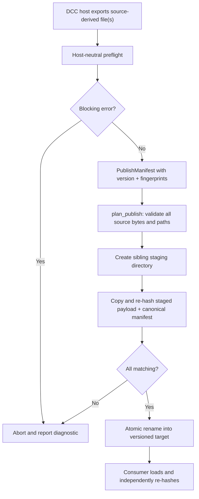

# From Blender, Maya or Houdini to a checked Kairo asset or Nuke shot

A shared production contract matters because a DCC tool can produce a plausible file that another tool cannot safely, deterministically or legally consume. This guide links the *actual* host adapters to the portable KairoPipelineCore manifest and publisher, then to Nuke and KairoAssets.

Read the [source-file reading order](SOURCE_READING_ORDER.md) alongside the code links. The word **verified** below means that the relevant declared bytes and policy have been checked; it does **not** mean a Maya/Houdini/Nuke/Blender installation was run or that a scientific simulation was proven correct.

## 1. Cross-application responsibilities

The workflow deliberately separates four layers.

| Layer | Example source | Owns |
| --- | --- | --- |
| Native DCC snapshot | [Blender adapter](https://github.com/swayam8624/KairoBlender/blob/docs/teaching-walkthrough-20261121/adapter.py), [Maya adapter](https://github.com/swayam8624/KairoMaya/blob/docs/teaching-walkthrough-20261121/python/kairo_maya/maya_adapter.py), [Houdini HOM](https://github.com/swayam8624/KairoHoudini/blob/docs/teaching-walkthrough-20261121/scripts/python/kairo_houdini/hom.py) | Reading actual host-native scene/nodes |
| Host-neutral preflight | [Blender validation](https://github.com/swayam8624/KairoBlender/blob/docs/teaching-walkthrough-20261121/validation.py), [Maya SceneDoctor](https://github.com/swayam8624/KairoMaya/blob/docs/teaching-walkthrough-20261121/python/kairo_maya/scenedoctor.py), [Houdini CacheGuard](https://github.com/swayam8624/KairoHoudini/blob/docs/teaching-walkthrough-20261121/scripts/python/kairo_houdini/cacheguard.py) | Typed diagnostics, admissible source and frame ranges |
| Portable publication | [manifest.py](../src/kairo_pipeline/manifest.py), [publish.py](../src/kairo_pipeline/publish.py), [paths.py](../src/kairo_pipeline/paths.py) | Safe paths, content fingerprints, versioned output, staged atomic replacement |
| Consumer validation | [Nuke ingest](https://github.com/swayam8624/KairoNuke/blob/docs/teaching-walkthrough-20261121/python/kairo_nuke/publish_ingest.py), [KairoAssets publish importer](https://github.com/swayam8624/KairoAssets/blob/docs/teaching-walkthrough-20261121/PipelinePublish.cppm) | Re-checking manifest and physical files before using the result |

A native application owns its current scene. Portable validation routines do not create Blender's `bpy` object, Houdini's `hou` node, Maya's DAG node or Nuke's Read node. A KairoAssets import does not acquire the original native DCC session or a GPU texture.

## 2. Stable published identity and schema

[`manifest.py`](../src/kairo_pipeline/manifest.py) declares the versioned `kairo.publish.v1` format. `PublishManifest` captures kind (asset, cache, render), project, named asset/shot, version, output files, dependencies and metadata. Each `PublishFile` has a normalized portable relative path, media/role and content fingerprint.

The parser uses a strict manifest size cap, item limits, identifier rules, duplicate-key rejection, case-folded path uniqueness and typed metadata. Canonical serialization makes the same published metadata produce the same manifest bytes.

These checks do not establish that a file's claimed SHA-256 digest matches its bytes: the publisher and consumer each perform that physical check. Nor does a hash establish permission to redistribute someone else's texture or audio.

## 3. Paths are a security and portability boundary

[`paths.py`](../src/kairo_pipeline/paths.py) rejects absolute paths, drive prefixes, traversal components, control characters, ambiguous Windows device names and nonportable separators. `casefold_path_key` identifies names that would collide on a case-insensitive filesystem.

`resolve_project_path` anchors a safe relative spelling to the intended root, but filesystem symlinks require separate checking. [`publish.py`](../src/kairo_pipeline/publish.py) checks each source file is regular and not a symlink before copying it into the staging directory.

**Exercise:** try source paths `../private.key`, `C:\\temp\\image.exr`, `CON.txt` and two files whose names differ only in case. The publisher must refuse ambiguous/escaping files rather than silently sanitize them into different assets.

## 4. Preflight and artifact generation in each host

**Blender.** `validation.py` checks snapshots of meshes/materials/transforms/images, and `publisher.py::export_and_publish` invokes `bpy` to export a derived glTF artifact. Its declared dependencies and file hashes become the portable manifest.

**Maya.** `scenedoctor.py::validate_scene` checks references, transforms, meshes and texture paths. `publisher.py::publish_scene` fingerprints the declared scene content and delegates to shared publication. A static Python preflight passing does not prove Autodesk Maya successfully exported a live scene.

**Houdini.** `cacheguard.py::inspect_cache` and `validate_cache` examine a temporal frame sequence, gaps and resource budget before `publisher.py::publish_cache` stages the declared cache files. A complete frame numbering sequence is not proof of physically valid simulation.

**Nuke.** `shotdoctor.py::validate_script` checks detached Read/Write path and frame-range records. `publish_ingest.py::inspect_publish` accepts supported cache/render kinds only, loads a strict manifest, then fingerprints files in the consumer's own filesystem. Nuke's host script still decides how to create Read nodes.

Each application uses the same `DiagnosticBag` approach so a typed error code can block publication, while a warning may provide a nonblocking quality note. Error policy must remain explicit in the host adapter.

## 5. Plan → stage → verify → publish

`plan_publish` makes no filesystem mutation; `publish_bundle` creates the staging copy, checks hashes, and replaces one directory entry. A replacement version uses backup/restore on a failed rename. This is a controlled filesystem operation, not a cross-filesystem database transaction or proof of crash-durable storage on every host.

**Exercise:** publish one asset successfully, then alter the source after planning, and finally simulate a wrong staged checksum. Observe that the destination is not accepted with mismatched bytes. Ingest the valid result using the independent Nuke/Assets validators.

## 6. Frame sequences and temporal integrity

[`sequences.py`](../src/kairo_pipeline/sequences.py) parses exactly one bounded `####` or `%04d` token, calculates expected filenames and scans existing frames. A cache from frame 1 through 100 with frame 37 missing is not equivalent to a complete cache. A duplicate numbered frame or inconsistent source version can also undermine a scientific or film result.

CacheGuard and ShotDoctor use those common utilities rather than duplicating platform-dependent pattern parsing. The declared time interval, padding, media type and frame fingerprints should travel with the published manifest.

## 7. Consuming portable artifacts in the engine

The C++ boundary [KairoAssets/PipelinePublish.cppm](https://github.com/swayam8624/KairoAssets/blob/docs/teaching-walkthrough-20261121/PipelinePublish.cppm) reads a DCC publish bundle, checks declared paths/fingerprints and makes stable asset references. Its import pipeline converts source files into portable CPU artifacts.

[KairoRenderer/AssetAdapters.cppm](https://github.com/swayam8624/KairoRenderer/blob/docs/teaching-walkthrough-20261121/AssetAdapters.cppm) subsequently maps those authored references into renderer-owned GPU handles. The publishing repository does not own the GPU upload, and the renderer does not own the artist's original DCC document.

## 8. Tests and evidence standards

Start with [`tests/test_manifest.py`](../tests/test_manifest.py), [`tests/test_publish.py`](../tests/test_publish.py), [`tests/test_paths_and_fingerprints.py`](../tests/test_paths_and_fingerprints.py) and [`tests/test_sequences.py`](../tests/test_sequences.py). Then run the host-neutral tests in each DCC integration repository, and only afterward record native Blender/Maya/Houdini/Nuke executions.

Evidence should state source SHA, DCC version/license, operating system, exported file list, exact manifest hash, verification command, expected vs actual diagnostics, and independent consumer readback. Content-provenance and redistribution rights belong in a separate source/media attribution record.

*This guide documents the current source contracts; it does not claim any new native DCC validation or licensing approval.*
